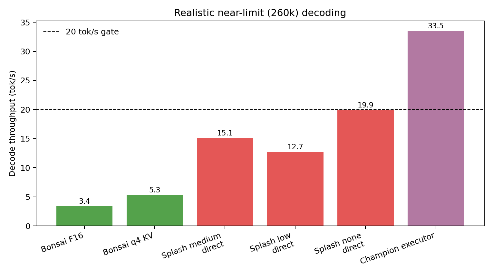
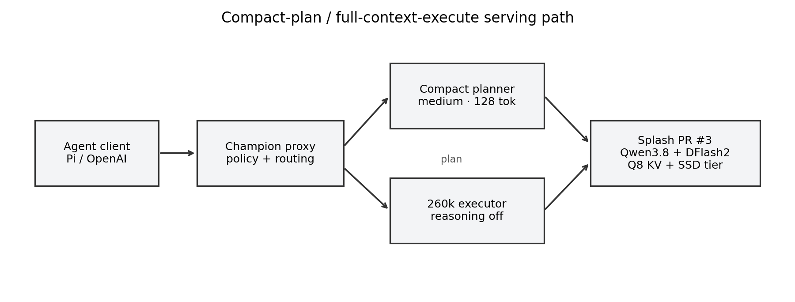

> **Editorial note (October 2026).** This is a historical research record,
> published unchanged apart from this note. The work predates later stock-Pi
> compaction and configuration changes; its acceptance numbers describe a
> two-stage compact-plan / full-context-execute proxy that is **not** the
> current local deployment and not stock Pi behaviour. The "winner"/"champion"
> language is a **historical configuration selection made under one machine's
> acceptance gates** — not a recommendation to deploy now and not a claim that
> this stack is the best available. Single-task selection and limited
> repetitions are listed in the paper's Threats to Validity. The measured
> 260,013-token context proof and the negative results remain as recorded.

# The 260K Wall

[](paper/main.pdf)
[](LICENSE)
[]()
[]()

**Model-specialized serving and planner–executor decomposition for Qwen3.8-27B agentic inference on Apple Silicon.**

This repository is a paper and reproducibility package, **not a new set of model weights**. It documents the search for a local LLM stack that simultaneously satisfies:

1. a real input of at least **256,000 tokens**;
2. at least **20 decode tokens/s**; and
3. the highest practical coding, reasoning, and tool-calling capability attainable after those hard gates pass.

All principal experiments ran on one Apple M4 Max with 64 GB unified memory. The winning deployment uses the Qwen3.8-27B Splash package, Splash PR #3's SSD cache tier, and a two-stage **compact-plan / full-context-execute** strategy.

## Paper

**The 260K Wall: Model-Specialized Serving and Planner–Executor Decomposition for Qwen3.8-27B Agentic Inference on Apple Silicon**

- [Read the paper (PDF)](paper/main.pdf)
- [LaTeX source](paper/main.tex)
- [Machine-readable result summary](results/processed/summary.json)
- [Full result notes](RESULTS.md)

## Headline results

| Result | Measurement |
|---|---:|
| Real context proof | **260,013 server-counted prompt tokens**, exact sentinel recovered |
| Planner | 128 tokens, medium reasoning, **37.03 tok/s** |
| Full-context executor | **38.82 tok/s** in acceptance run |
| Executor median | **33.53 tok/s** across 3 cooled runs |
| Reused executor prefix | **260,032–260,160 tokens** |
| Final-answer throughput including planner | **20.19 tok/s** in acceptance run |
| Aggregate generated throughput | **27.62 tok/s** |
| Production-proxy full-context streaming | **38.86 tok/s** |
| Production-proxy final-answer E2E including planner | **14.73 tok/s** for that 381-token response |
| Generated-code gate | Compiled and all assertions passed |
| OpenAI tool-call gate | Passed |
| Pi CLI gate | `PI_CHAMPION_FINAL_OK` |

> **Metric warning:** 38.86 tok/s is output-phase streaming decode. It is not the same as final-answer tokens divided by total planner + executor wall time. For the recorded proxy request, the latter was 14.73 tok/s. This repository reports both and does not present them as interchangeable.

## The 260K wall

Fast short-prompt results did not predict full-depth performance:



| Configuration | Real near-limit result | Verdict |
|---|---:|---|
| Ternary Bonsai 2, F16 KV | 260,013 tokens; 3.37 tok/s | context pass, speed fail |
| Ternary Bonsai 2, q4 KV | 260,013 tokens; 5.29 tok/s | context pass, speed fail |
| Splash, direct medium reasoning | 15.10 tok/s | speed fail |
| Splash, direct low reasoning | 12.70 tok/s median | speed fail |
| Splash, direct no-thinking | 19.90 tok/s median | unstable / below gate |
| **128-token plan + full-context execute** | **33.53 tok/s executor median** | **pass** |

Splash also completed the same 260,013-token sentinel prompt, although its cold request took 6,810.22 seconds. The advantage appears on reuse: the final runtime preserves both paged Q8 KV and Qwen3.8's recurrent Gated DeltaNet state.

## Method



1. A bounded task view is sent to the same Qwen3.8-27B target with `reasoning_effort=medium` and a 128-token budget.
2. The plan is injected as internal assistant reasoning history.
3. The original full message history and tools are retained.
4. The executor uses `reasoning_effort=none` against the cached 260k prefix.
5. Short outputs and tool calls can bypass planning to avoid fixed latency.

The planner does **not** replace the full context. It supplies a compact execution policy while the executor retains access to the original 260k history.

## Rejected alternatives

The repository preserves negative findings rather than only the winner:

- Qwen3.8-27B Q6: ~15.7 tok/s short context and ~3.9 tok/s near 103k.
- Native MTP: high acceptance but no meaningful Metal speedup.
- llama.cpp DFlash 2: loaded successfully in a new build but regressed Q6 decode.
- Dynamic V3 GGUF: useful quality allocation, not enough throughput.
- oMLX DFlash 2 with a 262k slot: 18.50 tok/s in the recorded screen.
- mlx-dspark DFlash with KV4: 18.87 tok/s in the recorded screen.
- Bonsai 2: excellent memory footprint and valid 260k context, but only 3.37–5.29 tok/s at full depth.
- Direct Splash medium/low reasoning: 12.70–15.10 tok/s at realistic full depth.

See [RESULTS.md](RESULTS.md) and [`results/raw/`](results/raw/) for the complete records and caveats.

## Repository layout

```text
├── paper/
│   ├── main.tex                     academic paper source
│   ├── main.pdf                     compiled paper
│   ├── make_figures.py              deterministic figure generator
│   └── figures/                     PDF and PNG figures
├── bench/
│   ├── context_probe.py             >=256k sentinel proof
│   └── bench_stream.py              streaming decode benchmark
├── deploy/
│   ├── champion_proxy.py            OpenAI-compatible plan/execute proxy
│   ├── test_champion_proxy.py       four unit tests
│   ├── start-splash-champion.example.sh
│   └── *.plist.example              persistent macOS service templates
├── results/
│   ├── raw/                         original JSON/JSONL records and sanitized logs
│   └── processed/                   summary, manifests, generated-code gates
├── docs/                             research and deployment notebooks
├── RESULTS.md                        human-readable result catalog
├── REPRODUCIBILITY.md                exact reproduction guide
└── CITATION.cff
```

## Reproduce the artifact checks

These checks do not require model weights:

```bash
python3 -m unittest discover -s deploy -p 'test_*.py' -v
python3 results/processed/generated_lru_champion.py
python3 results/processed/generated_lru_proxy.py
python3 paper/make_figures.py
cd paper && tectonic main.tex
cd .. && shasum -a 256 -c SHA256SUMS
```

`SHA256SUMS` covers the published artifact content except itself and the Hub-managed `.gitattributes` file.

For the full model and near-limit context run, follow [REPRODUCIBILITY.md](REPRODUCIBILITY.md). Expect the first 260k prefill to take hours. Do not infer active-depth speed from a server that merely allocates a 262k slot.

## Production configuration

The accepted runtime used:

| Component | Configuration |
|---|---|
| Target | `mlx-community/Qwen3.8-27B-4bit` packed for Splash |
| Draft | matched `incoai/Qwen3.8-27B-DFlash2` |
| Runtime | Splash 1.0 plus PR #3, commit `8ebf821630900af05e5527305fe3eeccc2c7e424` |
| Context | 262,144 tokens |
| KV | Q8 paged KV |
| Metal ceiling | 32 GiB |
| SSD cache tier | 8 GiB |
| Planner | medium reasoning, max 128 tokens |
| Executor | reasoning off |
| Public protocol | OpenAI-compatible loopback endpoint |

### Known implementation limitations

- The released proxy applies planner/executor decomposition to Chat Completions. `/v1/responses` currently passes through to Splash directly.
- The artifact version does not yet tokenize and strictly reserve space for injected plan messages. Requests already extremely close to 262,144 tokens should bypass planning or reserve headroom.
- Planner cost may push short final answers below 20 end-to-end final-answer tokens/s even when executor decode is well above 20 tokens/s.
- The SSD cache tier is an unmerged experimental Splash branch.

## Upstream artifacts

Weights are intentionally not redistributed here:

- [Qwen/Qwen3.8-27B](https://huggingface.co/Qwen/Qwen3.8-27B)
- [incoai/Qwen3.8-27B-Splash](https://huggingface.co/incoai/Qwen3.8-27B-Splash)
- [incoai/Qwen3.8-27B-DFlash2](https://huggingface.co/incoai/Qwen3.8-27B-DFlash2)
- [incoai/splash](https://github.com/incoai/splash)
- [Splash PR #3: SSD cache tier](https://github.com/incoai/splash/pull/3)
- [prism-ml/Ternary-Bonsai-2-27B-gguf](https://huggingface.co/prism-ml/Ternary-Bonsai-2-27B-gguf)

## Citation

```bibtex
@misc{klikteam2026the260kwall,
  title        = {The 260K Wall: Model-Specialized Serving and Planner--Executor
                  Decomposition for Qwen3.8-27B Agentic Inference on Apple Silicon},
  author       = {Xu, Chengyi and {{KLIK team}}},
  year         = {2026},
  month        = sep,
  howpublished = {Hugging Face reproducibility artifact},
  url          = {https://huggingface.co/datasets/ChengyiX/260k-wall}
}
```

## License

The paper text, benchmark code, proxy code, and original figures in this repository are MIT-licensed. Model weights and upstream runtimes retain their respective upstream licenses. No credentials or model weights are included.
